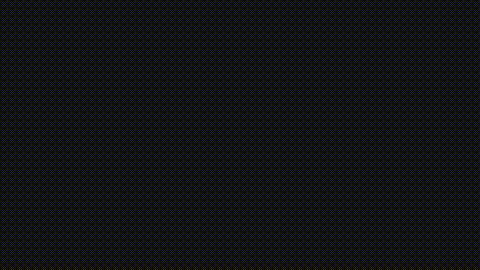

# 📐 Visual Precalculus (Precálculo Animado con Manim)

Animaciones matemáticas rigurosas y didácticas desarrolladas con [Manim Community Edition](https://www.manim.community/), basadas en la colección de libros de texto de Precálculo (**Colección Yachay Tech / Editorial Amarun**, Dr. Juan Mayorga-Zambrano).

El objetivo de este repositorio es resolver y visualizar los **ejercicios pares** de cada capítulo, proporcionando explicaciones animadas con una duración prudente, ritmo pedagógico equilibrado e identidad gráfica andina.

---

## 🎨 Principios de Diseño e Identidad Visual

Las animaciones siguen un estándar pedagógico y estético unificado mediante la clase base [`AmarunExerciseScene`](common/base_scene.py):

* **Enunciado Permanente:** Fijado en la parte superior en un recuadro institucional rojo poncho (`#a32f30`), visible durante todo el video sin desaparecer.
* **Metamorfosis Algebraica (Estilo 3Blue1Brown):** En el panel izquierdo, las expresiones matemáticas mutan directamente en su lugar (`ReplacementTransform`), mientras el panel derecho actualiza la justificación teórica paso a paso.
* **Tachado Explícito:** Al simplificar factores fraccionarios, se trazan líneas diagonales en rojo poncho sobre los términos cancelados, con pausas de asimilación antes de la reducción.
* **Estructura Pedagógica (Preferencia de ~6 Pasos):** De preferencia, se procura estructurar la resolución en torno a un desglose de 6 etapas progresivas bien delimitadas, adaptándose con flexibilidad según la naturaleza y complejidad del problema sin forzar pasos artificiales ni omitir justificaciones deductivas.
* **Barra de Progreso Interactiva:** En la parte inferior ($y = -3.55$), una línea con nodos dinámicos indica la etapa activa (amarillo inca), las etapas superadas (verde andino) y el rótulo de la fase actual.
* **Interpretación Gráfica Cartesiana:** Cada ejercicio concluye con la visualización de la curva en el plano cartesiano, destacando puntos abiertos (discontinuidades evitables), asíntotas, vértices y cortes con los ejes.
* **Paleta Andina Institucional ([common/styles.py](common/styles.py)):**
  * Fondo: Carbón noche andino (`#151212`)
  * Enunciado / Títulos: Blanco alpaca (`#fdfbf7`) y Turquesa Amarun (`#8ec3c0`)
  * Énfasis algebraico: Oro Inca (`#f6b840`) y Terracota (`#db5a38`)
  * Conclusiones: Verde esmeralda andino (`#48bb78`)
  * Exclusiones / Tachado: Rojo Poncho Yachay (`#a32f30`)

---

## 🎬 Niveles de Calidad y Resolución de Renderizado

Manim permite compilar cualquier ejercicio en 5 niveles de resolución y tasa de cuadros mediante la bandera `-q` (`--quality`):

| Bandera | Perfil | Resolución | Tasa de Cuadros | Carpeta de Salida | Propósito Recomendado |
| :---: | :--- | :---: | :---: | :--- | :--- |
| **`-ql`** | *Low* (Baja) | **854 × 480** (480p) | 15 fps | `media/.../480p15/` | **Desarrollo y pruebas rápidas** (renderiza en ~15–20 s) |
| **`-qm`** | *Medium* (Media) | **1280 × 720** (720p HD) | 30 fps | `media/.../720p30/` | Revisiones intermedias y dispositivos móviles |
| **`-qh`** | *High* (Alta) | **1920 × 1080** (1080p FHD) | 60 fps | `media/.../1080p60/` | **Estándar para YouTube, clases virtuales y proyectores** |
| **`-qp`** | *Production* (2K) | **2560 × 1440** (1440p QHD) | 60 fps | `media/.../1440p60/` | Monitores de alta densidad y edición de video |
| **`-qk`** | *FourK* (Ultra Alta) | **3840 × 2160** (4K UHD) | 60 fps | `media/.../2160p60/` | **Máxima calidad cinematográfica / Máster de archivo** |

### ⚡ Automatización con `render.py` (Recomendado)

El repositorio incluye un script CLI inteligente (`render.py`) que detecta automáticamente los ejercicios, ejecuta Manim en la resolución deseada y genera de forma inmediata la vista previa GIF optimizada:

```bash
# 1. Previsualización rápida (480p15 + GIF automático):
python render.py 5.2
python render.py 5.4

# 2. Renderizado en Alta Calidad (Full HD 1080p a 60 fps):
python render.py 5.2 --high

# 3. Renderizado en Máxima Calidad (4K Ultra HD a 60 fps):
python render.py 5.4 --4k

# 4. Listar todos los ejercicios disponibles y su estado:
python render.py --list

# 5. Renderizar todos los ejercicios en bloque:
python render.py all --low
```

### Comandos Manuales de Manim

Si prefieres invocar directamente las herramientas del sistema:

* **Desarrollo rápido (480p15):**
  ```bash
  manim -ql libro2_precalculo/cap05_funciones_reales/ej_05_02.py Ejercicio05_02
  ```
* **Calidad alta (1080p60):**
  ```bash
  manim -qh libro2_precalculo/cap05_funciones_reales/ej_05_02.py Ejercicio05_02
  ```
* **Máxima resolución (4K UHD 60fps):**
  ```bash
  manim -qk libro2_precalculo/cap05_funciones_reales/ej_05_02.py Ejercicio05_02
  ```
* **Generar GIF optimizado manualmente:**
  ```bash
  ffmpeg -y -i media/videos/ej_05_02/480p15/Ejercicio05_02.mp4 \
         -vf "fps=10,scale=480:-1:flags=lanczos" \
         docs/previews/ej_05_02.gif
  ```

---

## 📂 Estructura del Repositorio

```text
visual-precalculus/
├── common/                             # Módulos compartidos y arquitectura
│   ├── base_scene.py                  # AmarunExerciseScene (clase base reutilizable)
│   ├── styles.py                      # Paleta de colores andina e identitaria
│   └── __init__.py
├── docs/                               # Previews y material de documentación
│   └── previews/                      # GIFs optimizados para README
├── images/                             # Activos gráficos institucionales
│   ├── Fondo_Poncho.jpg               # Muestra textil del poncho Yachay Tech
│   └── logo_Amarun.jpg                # Isotipo oficial de Editorial Amarun
├── libro2_precalculo/                 # Libro 2: Precálculo 2
│   ├── cap05_funciones_reales/        # Capítulo 5: Funciones reales
│   │   ├── ej_05_02.py                # Ejercicio 5.2 (RMD, dominio y gráfico)
│   │   ├── ej_05_04.py                # Ejercicio 5.4 (Paridad de funciones y simetría)
│   │   ├── ej_05_06.py                # Ejercicio 5.6 (Propiedades del valor absoluto y dilatación)
│   │   ├── ej_05_08.py                # Ejercicio 5.8 (Desigualdad triangular y función distancia)
│   │   ├── ej_05_10.py                # Ejercicio 5.10 (Inyectividad y prueba de recta horizontal)
│   │   ├── ej_05_12.py                # Ejercicio 5.12 (Paridad de la función inversa y simetría)
│   │   ├── ej_05_14.py                # Ejercicio 5.14 (Monotonía de la suma y tasa de variación)
│   │   ├── ej_05_16.py                # Ejercicio 5.16 (Monotonía e inyectividad de x³ + 1)
│   │   ├── ej_05_18.py                # Ejercicio 5.18 (Propiedades de logaritmos e isomorfismo)
│   │   ├── ej_05_20.py                # Ejercicio 5.20 (Inecuación racional y conjunto solución)
│   │   ├── ej_05_22.py                # Ejercicio 5.22 (Ecuaciones con valor absoluto)
│   │   ├── ej_05_24.py                # Ejercicio 5.24 (Inecuación con valor absoluto anidado)
│   │   ├── ej_05_26.py                # Ejercicio 5.26 (Inecuación de doble acotación |3|x|-1| ≤ 5)
│   │   ├── ej_05_28.py                # Ejercicio 5.28 (Desigualdad triangular inversa)
│   │   ├── ej_05_30.py                # Ejercicio 5.30 (Inecuaciones con radicales y método integrador)
│   │   ├── ej_05_32.py                # Ejercicio 5.32 (Ecuación con radicales simétricos y conjugado)
│   │   ├── ej_05_34.py                # Ejercicio 5.34 (Ecuación con radicales de distinto orden ⁵√ y ⁴√)
│   │   └── ej_05_36.py                # Ejercicio 5.36 (Inecuaciones cuadráticas y fraccionarias con valor absoluto)
│   ├── cap06_funciones_trigonometricas/
│   ├── cap07_numeros_complejos/
│   ├── cap08_polinomios_racionales/
│   └── cap09_sucesiones_reales/
├── TRACKING.md                         # Hoja de ruta y checklist de ejercicios pares
├── requirements.txt                   # Dependencias de Python
├── render.py                          # CLI inteligente de automatización de renders
└── .gitignore                         # Exclusión de renders pesados locales
```

---

## 🚀 Instalación y Requisitos

### 1. Dependencias del Sistema

Se requiere Python 3.10+ junto con FFmpeg y LaTeX para la rasterización de fórmulas:

```bash
# En Ubuntu / Debian / WSL:
sudo apt update
sudo apt install -y libcairo2-dev libpango1.0-dev pkg-config \
                    ffmpeg texlive-latex-base texlive-latex-extra \
                    texlive-fonts-recommended dvisvgm
```

### 2. Dependencias de Python

```bash
pip install -r requirements.txt
```

---

## 📋 Catálogo y Progreso de Ejercicios

Consulta [TRACKING.md](TRACKING.md) para ver la lista completa de ejercicios pares cubiertos, en desarrollo y planificados.

### Muestra 1: Capítulo 5 · Ejercicio 5.2
> **Tema:** Regla del Máximo Dominio (RMD)  
> **Problema:** Encontrar el dominio de $h(x) = \ln\left(\frac{x^3+1}{x+1}\right)$  
> **Resultado:** $\operatorname{Dom}(h) = \mathbb{R} \setminus \{-1\}$  
> **Comportamiento Gráfico:** Curva $y = \ln(x^2 - x + 1)$ con discontinuidad evitable (punto abierto) en $(-1, \ln 3)$.



### Muestra 2: Capítulo 5 · Ejercicio 5.4
> **Tema:** Paridad de Funciones (Teorema 5.4)  
> **Problema:** Demostrar paridad para $f \cdot g$, $f/g$, $f_1 + f_2$ y $g_1 + g_2$.  
> **Resultado:** $f \cdot g$ y $f/g$ son impares; $f_1 + f_2$ es par; $g_1 + g_2$ es impar.  
> **Comportamiento Gráfico:** Simetría axial (eje Y) vs. simetría central (origen).


### Muestra 3: Capítulo 5 · Ejercicio 5.6
> **Tema:** Propiedades del Valor Absoluto (Teorema 5.6)  
> **Problema:** Demostrar $|a \cdot b| = |a| \cdot |b|$ para todo $a, b \in \mathbb{R}$ usando la definición $|x| = \sqrt{x^2}$.  
> **Resultado:** Radicando $(ab)^2 = a^2 b^2 \implies \sqrt{a^2}\sqrt{b^2} = |a||b|$. Corolario: $|a/b| = |a|/|b|$ si $b \neq 0$.  
> **Comportamiento Gráfico:** Dilatación y contracción métrica en la familia de curvas $f_k(x) = |k \cdot x| = |k||x|$.


### Muestra 4: Capítulo 5 · Ejercicio 5.8
> **Tema:** Desigualdad Triangular (Corolario 5.11)  
> **Problema:** Demostrar $||x| - |y|| \le |x - y|$ y $|x - y| \le |x - a| + |a - y|$ para todo $x, y, a \in \mathbb{R}$.  
> **Resultado:** Acotamiento doble $-|x - y| \le |x| - |y| \le |x - y| \implies ||x| - |y|| \le |x - y|$. Descomposición con punto intermedio.  
> **Comportamiento Gráfico:** Función cuenca $g(a) = |x - a| + |a - y|$ con piso mínimo en $|x - y| = 3$ e intervalo de igualdad $a \in [-1, 2]$.


### Muestra 5: Capítulo 5 · Ejercicio 5.10
> **Tema:** Inyectividad de Funciones (Sección 5.5)  
> **Problema:** Probar que $g: \mathbb{R} \to \mathbb{R}$ con $g(x) = 2x^3 - 1$ es inyectiva y graficar en el plano cartesiano.  
> **Resultado:** $(x_1 - x_2)(x_1^2 + x_1 x_2 + x_2^2) = 0 \implies x_1 = x_2$ pues $(x_1 + x_2/2)^2 + \frac{3}{4}x_2^2 > 0$ si $(x_1, x_2) \neq (0, 0)$.  
> **Comportamiento Gráfico:** Curva cúbica $g(x) = 2x^3 - 1$ con corte en $(0, -1)$, verificando el test de la recta horizontal con preimagen única en $(1, 1)$.


### Muestra 6: Capítulo 5 · Ejercicio 5.12
> **Tema:** Paridad de la Función Inversa (Teorema 5.15)  
> **Problema:** Probar que si $f: \mathbb{R} \to \mathbb{R}$ es biyectiva e impar, entonces $f^{-1}$ es también impar.  
> **Resultado:** $-y = -f(x) = f(-x) \implies f^{-1}(-y) = -x = -f^{-1}(y)$ para todo $y \in \mathbb{R}$.  
> **Comportamiento Gráfico:** Simetría axial respecto a la diagonal $y = x$ y simetría central respecto al origen $(0, 0)$ en las curvas $f(x) = x^3$ y $f^{-1}(x) = \sqrt[3]{x}$.


### Muestra 7: Capítulo 5 · Ejercicio 5.14
> **Tema:** Monotonía de la Suma de Funciones (Teorema 5.18)  
> **Problema:** Probar que la suma de crecientes es creciente, y que creciente más estrictamente creciente es estrictamente creciente.  
> **Resultado:** $f(x_1) \le f(x_2) \land g(x_1) < g(x_2) \implies (f+g)(x_1) < (f+g)(x_2)$. Aditividad de la tasa de variación $\alpha_{f+g} = \alpha_f + \alpha_g > 0$.  
> **Comportamiento Gráfico:** Superposición cartesiana de $f(x) = x$ y $g(x) = x^3$ generando la curva más inclinada $(f+g)(x) = x + x^3$, evaluada en $x = 1$.


